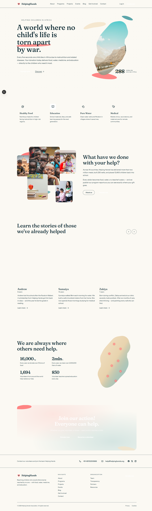

# Helping Hands Association

Website for the Helping Hands Association NGO: donations, volunteers, events, a blog and
an admin CMS.

The code lives in two repositories:

| Part | Repository | Stack |
|---|---|---|
| Site | [hh-frontend](https://github.com/MUYAHGaious/hh-frontend) | Next.js 16, TypeScript, Tailwind CSS v4 |
| API | [hh-backend](https://github.com/MUYAHGaious/hh-backend) | FastAPI, SQLAlchemy 2 (async), PostgreSQL, Alembic |

This repository holds the design specs and plans in `docs/` and the screenshots.

---

Built by [Muyah Gaious Angwe](https://muyah.dev).
